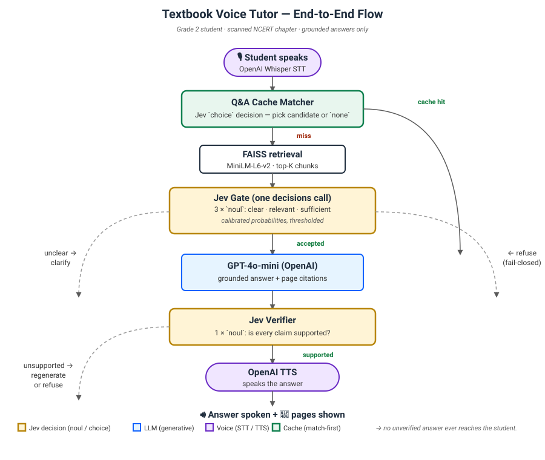
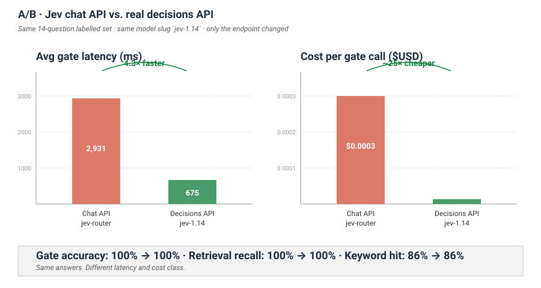

# Textbook Voice Tutor

A voice-enabled Python tutor that answers Grade 2 (~7 year old) questions grounded strictly in a scanned textbook chapter. The pipeline is **retrieve → gate → generate → verify → speak**, with Jev's real `/api/alpha/decisions` endpoint doing the heavy lifting on the gate and verifier, and a Q&A cache that uses Jev's `choice` decision to shortcut common questions.



See [`article.md`](article.md) for the full write-up — the Jev chat-vs-decisions API discovery, the A/B numbers, and lessons learned.

---

## Highlights

- **Grounded answering.** No answer leaves the pipeline unless Jev's verifier confirms every claim is supported by the retrieved passages.
- **Real Jev decisions API** (`/api/alpha/decisions`) — 2.5× faster, ~25× cheaper than the chat-wrapper, with calibrated `noul` and `choice` probabilities.
- **Voice-first UX.** Push-to-talk mic → Whisper → pipeline → GPT-4o-mini answer → OpenAI TTS replies aloud. Follow-up questions carry conversation context.
- **Q&A cache** — pre-generated Q&A pairs matched by Jev `choice` with a 0.6 confidence threshold. 50% hit rate out of the box, 60× cheaper per cache-hit question.
- **Deterministic policy state machine.** Clarify → expand → accept → refuse → fail-closed — the LLM never runs on insufficient evidence.
- **170 fast tests** plus live-API tests behind markers for Jev + OpenAI.

## Measured results (14-question labelled set, scanned NCERT Plants chapter)

| | Chat API via `jev-router` | **Decisions API via `jev-1.14`** | **+ Q&A cache (50% hit rate)** |
|---|---|---|---|
| Gate accuracy | 100% | 100% | 100% |
| Avg gate latency | 2,931 ms | **675 ms** | 497 ms |
| **Avg total** | 4,092 ms | **1,652 ms** | **1,434 ms** |
| P95 total | 6,705 ms | 2,854 ms | **2,396 ms** |
| Cost / gate call | ~$0.0003 | ~$0.000013 | — |




Reproduce the numbers:

```bash
python -m evaluation.evaluate_pipeline --dataset evaluation/datasets/plants.json --out data/eval
python -m evaluation.evaluate_pipeline --dataset evaluation/datasets/plants.json --out data/eval --qa-cache
```

## Setup

```bash
python3 -m venv .venv
source .venv/bin/activate
pip install -r requirements.txt
cp .env.example .env   # then fill in keys
```

System deps:

```bash
brew install tesseract   # or your OS equivalent
```

`.env` keys:

- `OPENAI_API_KEY` — Whisper, TTS, `gpt-4o-mini` for the LLM answer
- `OPENROUTER_API_KEY` — Jev decisions API
- `JEV_MODEL=typesafe/jev-1.14` *(not `jev-router` — see `article.md`)*
- `LLM_PROVIDER=openai`, `LLM_MODEL=gpt-4o-mini`
- `STT_LANGUAGE=en` (prevents Whisper auto-detect drift)

## Run

```bash
streamlit run app.py
```

Workflow:

1. **Ingest** tab → upload a chapter PDF → *Build index*. OCR runs automatically for scanned pages.
2. **Ingest** tab → *Q&A cache corpus* → set pairs-per-chunk (10–20) → *Build / rebuild Q&A cache*.
3. **Ask a question** tab → toggle **🎙 Voice mode** → press the mic → speak → stop.

## Project layout

```
textbook-voice-tutor/
├─ app.py                       # Streamlit UI
├─ ingestion/                   # PDF, OCR, chunker, chapter ingest, Q&A corpus
├─ retrieval/                   # embeddings, FAISS store, retriever, Q&A matcher
├─ decision/                    # Jev decisions client, policy state machine
├─ llm/                         # grounded answer generator + question rewriter
├─ voice/                       # OpenAI Whisper STT, OpenAI TTS
├─ conversation/                # controller, context, clarification merging
├─ storage/                     # SQLite schema + repository
├─ evaluation/                  # labelled dataset + CLI evaluator
├─ tests/
├─ docs/images/                 # architecture + A/B charts
├─ article.md                   # the Medium write-up (full story + numbers)
└─ requirements.txt
```

## Tests

```bash
pytest                     # 170 fast tests, no network, ~1 s
pytest -m live_openai      # OpenAI STT + TTS smoke tests (needs OPENAI_API_KEY)
pytest -m live_jev         # Real Jev decisions API tests (needs OPENROUTER_API_KEY)
pytest -m live_model       # Real MiniLM embeddings smoke test
```

## Attribution

The chapter scanned for development is from the [NCERT](https://ncert.nic.in/) curriculum, used under its open-access terms for personal educational purposes. **No chapter content is redistributed in this repository.** Bring your own scanned PDF.

## License

MIT. See `LICENSE`.
